# BD22 VR Weapons 2.0

**Brutal Doom v22 in VR. Your hands. Every gun.**

Grab the rifle by its handguard and the trigger is under your finger. Rip the magazine out, reach
to your belt, slam a fresh one home, and rack it. Break the Super Shotgun, thumb in two shells, flick
it shut. Hold the Ruger to your eye and the scope is a real 3x window, not a sticker. Pull the pin
with your other hand and throw. Choke up on the chainsaw by its top handle. Swing the Dragonslayer
two-handed. Every gun in Brutal Doom, held, aimed, fired and reloaded with your own two hands.

Project conceptualized, directed and coordinated by **PresidentKoopa**. All coding done by

A VR weapon pack for **Brutal Doom v22** (`brutal22test6.pk3`) on **QuestZDoom 17.3**, built for **standalone
Quest**. Stock engine, no engine changes, all script. Brutal Doom's guns stay Brutal Doom's guns: same damage, same
rate of fire. Now you hold them.

- **It stands alone.** Hands on every gun, 23 guns reloaded by hand, live scopes, real bullets, a gun in each hand.
- **LegenDoom works out of the box.** Load LegenDoom 3.0 and legendary monsters drop legendary Brutal Doom VR guns,
  with 178 of its 180 effects. No patch.
- **It comes with four companions** from the [RSQ UBQ Series](https://github.com/presidentkoopa/RSQ_UBQSeries):
  RSQ Melee, Tactical Rig, Gun Cards and Laser Sight, released alongside it. The rest of the Series plays well with it too.


**[Install](#install)** · **[What you get](#what-you-get)** · **[LegenDoom](#legendoom-built-in)** · **[Alongside](#released-alongside-it)** · **[Options](#options)** · **[Good to know](#good-to-know)** · **[Changelog](CHANGELOG.md)** · **[Credits](#credits)**

<p align="center"></p>

<a name="install"></a>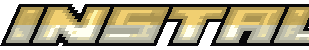

Everything is in the [pk3/](pk3/) folder. Load, in this order:

```
doom2.wad  ->  brutal22test6.pk3  ->  02_BD22_VoxelPack.pk3  ->  03_BD22_VR-Reloaded_2.0.5n.pk3
```

- **Doom 2, not Freedoom.** The voxel pack names Doom 2's own sprites.
- **LegenDoom 3.0** goes right after doom2. Nothing else is needed for it, and the old `LD_BD22VR_Patch.pk3` must not
  be loaded.
- **XMVE** (files 04 to 07) is the optional monster expansion, loaded after the weapons in number order.
- **Released alongside:** `RSQ_Melee.pk3`, `RSQ_TacticalRig.pk3`, `RSQ_GunCards.pk3` and `RSQ_LaserSight.pk3`, after the
  weapons. See [Released alongside it](#released-alongside-it).
- **RSQ_BDXMTiers** (twelve files, one a colour) is the painted colour art for RSQ Monsters' tiers on Brutal Doom's
  and XMVE's monsters. Only for the [RSQ UBQ Series](https://github.com/presidentkoopa/RSQ_UBQSeries).
- **Build it yourself:** `python build.py` zips `src/` into `BD22_VR-Reloaded_<VERSION>.pk3`.

<p align="center"></p>

<a name="what-you-get"></a>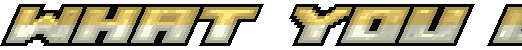

<a name="every-gun-reloads-by-hand"></a>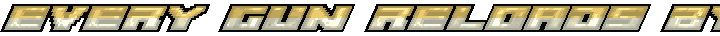


**23 guns**, each the way that gun really loads. The old part slides out and falls. You take a fresh one from your
belt, bring it to the gun and push it home.

| How | Guns |
|---|---|
| **Magazine, and rack it if you ran dry** | Rifle, Pistol, SMG, MP40, Assault Shotgun, Ruger |
| **Cell or magazine, no rack** | Railgun, Plasma Gun |
| **One rocket, in from the side** | Rocket Launcher |
| **Drum, box, canister, skull** | MG42 (100), Machinegun (100), Minigun (200), Flamethrower (100), Unmaker (200), Devastator (50), Hellish launcher (6), Incendiary Launcher (6), Nuke Launcher (1) |
| **Break it open** | Super Shotgun, Grenade Launcher, Shotvolver, Silvergun |
| **Shells through the port, then pump** | Shotgun (8 + 1) |
| **The launcher under the barrel** | Rifle and Machinegun: unlatch, push the tube forward, load, pull it shut |

- **The bolt locks open** on the Rifle, Pistol, SMG and Assault Shotgun when you fire them dry. A short tug lets it go.
- **A round stays in the chamber,** so you only rack after running dry.
- **A dropped magazine loses nothing.** Its rounds are kept and come back when the new one seats.
- **Break-open guns shut with a flick of the wrist,** or push them shut with your other hand.
- **Revolvers take a speedloader or one round at a time.** Your choice.
- **Top off the shotgun whenever you like.** No button; just push shells in.
- **Brutal Doom never reloads its heavy guns.** Here nine of them have real magazines, cut out of each gun's own model.
- **Don't want it?** Turn **VR Reloading** off and every gun reloads as Brutal Doom made it.

<a name="hands-on-every-gun"></a>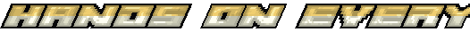


- **28 grips,** one for every weapon: a finger on the trigger that squeezes when you fire, and a support hand on the
  forend, pump or foregrip.
- **25 reload holds** for the off hand, one for every magazine, shell, rocket, loader and skull you can pick up.
- **Shots leave the muzzle you see** and go down the barrel you see, on 26 guns.
- **18 skin tones,** from porcelain to a black glove.

<a name="legendoom-built-in"></a>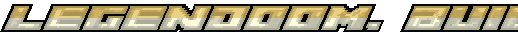

**Load LegenDoom 3.0 and legendary monsters drop legendary Brutal Doom VR guns.** No patch and no other mod. The pack
finds LegenDoom by itself and switches its LegenDoom mode on.

- **178 of LegenDoom's 180 effects** work on these guns. The two left out are Favoured and DualWield, which has no
  point when you already hold a gun in each hand.
- **22 guns over LegenDoom's nine slots** can be legendary: fists, chainsaw, pistols and the Silvergun, both shotguns,
  the Minigun and Rifle, the Rocket Launcher, the Plasma Gun and the BFG.
- **A legendary covers its whole family.** A Chaingun legendary powers the Rifle too, and a Pistol one the Silvergun.
- **It works with a gun in each hand:** the off-hand copy carries the legendary.
- **It works with hand reloading:** ammo effects act on the magazine you loaded, and speed effects quicken the trigger,
  never your hands.
- **The drop looks like the gun,** in LegenDoom's rarity glow, with LegenDoom's own jingle and info screen.
- **One legendary a slot.** To take a new one, drop the old one first (Drop Legendary, on its options page).
- **With RSQ Miniboss loaded as well** (Champions is built into it), legendary guns come only from a miniboss
  fight, rarer ones from higher tiers, and its kiosk sells them.

<a name="shooting"></a>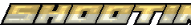

- **True Bullets** (on): every bullet is a real round that flies from the muzzle, with a tracer, and lands with Brutal
  Doom's own damage. Off is Brutal Doom's hitscan.
- **Ballistics** (Low): dust, sparks and chips that match the surface, impact sounds, ricochets, a muzzle flash that
  lights the room, and a gunshot echo that differs indoors and out.
- **Brass from the gun's own port,** as 3D casings.
- **Steady a gun with both hands and it shoots tighter** (Two-Hand Spread).
- **Every gun fires at Brutal Doom's own rate.** QuestZDoom lets a held trigger fire some guns too fast; this holds them.
- **The Rocket Launcher locks on:** hold alt fire, mark up to three monsters, let go, and three rockets home.
- **Slugs** for the Assault Shotgun and the Shotvolver; burst or full auto on the SMG.

<a name="live-scopes"></a>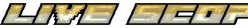


The **Ruger** and the **Railgun** have a real 3x picture in the lens, and both are zeroed at 30 metres. Alt fire
turns the scope off and on, which saves the Quest a second view of the world.

<a name="a-gun-in-each-hand"></a>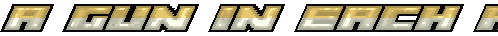

- **13 guns have an off-hand twin:** Pistol, Silvergun, Shotvolver, SMG, MP40, Rifle, Plasma Gun, Shotgun, Super
  Shotgun, Assault Shotgun, Railgun, Minigun and the Axe.
- **Pick a gun up and you already own its twin,** loaded. Brutal Doom's Dual key draws it.
- **Reload by pointing the gun at the floor and pulling its trigger,** or press Reload and both hands reload.

<a name="grenades-blades-and-doors"></a>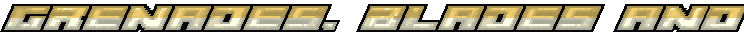

- **The grenade:** pull the pin with your other hand, or with your teeth. Swing and let go to throw; let go while
  still and it cooks.
- **Shoot your own grenade out of the air.**
- **The axe:** swing to cut, hold and let go to throw. Paint a monster first and the axe homes on it. You can carry
  ten.
- **The Dragonslayer** needs a real swing, and two hands double its damage.
- **The chainsaw** cuts whatever it touches while you hold the trigger.
- **Real punches** with either fist, and a **pistol whip** with any pistol or revolver.
- **Lift doors by hand:** take hold of a door and raise it. Past 40% it opens the rest of the way.

<a name="released-alongside-it"></a>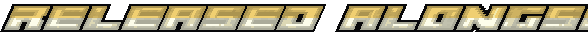

Four mods from the [RSQ UBQ Series](https://github.com/presidentkoopa/RSQ_UBQSeries) are released with this pack. Each is its own pk3, loaded after the weapons,
and each works without the others. Get them from the Series' [pk3 folder](https://github.com/presidentkoopa/RSQ_UBQSeries/tree/main/pk3).

- **[RSQ Melee](https://github.com/presidentkoopa/RSQ_UBQSeries/blob/main/Melee/README.md)** (`RSQ_Melee.pk3`): fighting with your body. Jabs, hooks and
  uppercuts read from your hand, open-palm slaps for fireballs, the gun-butt shove. It takes over this pack's punch,
  pistol whip and butt strike.
- **[RSQ Tactical Rig](https://github.com/presidentkoopa/RSQ_UBQSeries/blob/main/TacticalRig/README.md)** (`RSQ_TacticalRig.pk3`): your guns on your body. Six
  holsters, a grenade spot, and an ammo pouch that every reload in this pack takes its ammo from.
- **[RSQ Gun Cards](https://github.com/presidentkoopa/RSQ_UBQSeries/blob/main/GunCards/README.md)** (`RSQ_GunCards.pk3`): ammo cards on your guns and a status
  card on your wrist when you check your watch. It can take health, armour and ammo off the HUD, and a worn gun
  spreads wider.
- **[RSQ Laser Sight](https://github.com/presidentkoopa/RSQ_UBQSeries/blob/main/LaserSight/README.md)** (`RSQ_LaserSight.pk3`): a laser out of every gun's own
  barrel, both hands, with a dot where the shot will land.

<a name="with-the-rest-of-the-series"></a>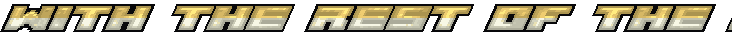

The Series is a game mode of its own, built with Brutal Doom in mind and not dependent on it. Each of these is found
by name, and the pack needs none of them.

- **RSQ Grenade:** with its "Replace Brutal Doom's Grenade" on, Brutal Doom's grenade stands down, and the launcher
  under the Rifle fires RSQ Grenade's kinds.
- **RSQ Distance Grab:** pull a thrown axe back to your hand.
- **RSQ SlowMo:** a thrown grenade can keep some speed in slow motion, so you can throw it and then shoot it.
- **RSQ Miniboss:** its kiosk sells this pack's legendary guns.
- **A saber, ShieldSaw, flare, flashlight or whip in the off hand:** the main gun reloads by the gesture.

<a name="guns-you-wont-find"></a>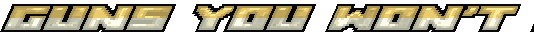

Six guns are switched off, each with a stand-in wherever a map would place it: MP40 (SMG), MG42 (Minigun), Devastator
and Hellish Missile Launcher (Rocket Launcher), Flame Cannon (Flamethrower), Incendiary Launcher (Grenade Launcher).
**Cheat Extra Weapons** lets cheats give the real six.

<p align="center"></p>

<a name="options"></a>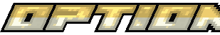

**Options → BD22 VR Weapons** (also in Brutal Doom's own menu). The main page is short: hands and skin tone,
reloading, the HUD (Brutal Doom's status bar or the **VR Row**: each hand's ammo on its side, the face between health
and armour), True Bullets, Ballistics, throwing, punching and Instant Switch. Under it are **Dual Wield**, **Voxels**
and **Test and Debug**, where everything else lives. With LegenDoom loaded there is a **LEGENDOOM x BD22 VR** page too.

**Off until you turn them on:**

- **Butt Strike**
- **Pistol Semi Auto** and **Shotgun Slug**
- **Silvergun For Pistol**, **Two Silverguns**, **Machinegun For MG42**
- **Dual Wield:** Shotgun, Super Shotgun, Assault Shotgun and Railgun
- **Two-Hand Shotguns**
- **Slow Motion Only**, **Slow Motion Boost**
- **Cheat Extra Weapons**
- On the LegenDoom page: **Legendary Name**, and **Champions Drop** under its Test and Debug

Everything else described on this page is on. The pack binds no keys.

<p align="center"></p>

<a name="good-to-know"></a>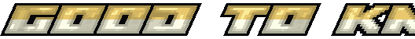

- **With a gun in your off hand there is no hand reloading.** Each gun reloads by the gesture or the Reload button.
- **The under-barrel launcher only unlatches while you two-hand the gun,** and the latch is always the off trigger.
- **Scopes and Hand Skin Tone are single player only.**
- **Voxel "Spent casings" overrides Real Casing Models.**
- **Your fists punch when you swing them.** The trigger does not throw a canned punch in VR.
- **With LegenDoom loaded,** Brutal Doom's own Dual Pistols weapon is put away. Hold a pistol in each hand instead.

<p align="center"></p>

<a name="changelog"></a>

Every build since 2.0.2a, and the release notes for 2.0 and 1.99, are in **[CHANGELOG.md](CHANGELOG.md)**.

<p align="center"></p>

<a name="credits"></a>
**BD22 VR Weapons Q**: project conceptualized, directed and coordinated by **PresidentKoopa** (Radiant Silvergun). All coding done by agentic **Claude** (Anthropic), working under his direction.

Weapon models: **br_vr** by ajantaju (Brutal Doom VR Weapons, BD v21), made from:
- Grenade by Gomuz; MP40 by Krystian; Shotgun by serg-654; Beretta M9 by damkung13
- Axe by martn00; M4A1 by seandxyz; Minigun by overlordchaos; DBS-2 by ironcladmax501
- SemiAuto Shotgun by Derak Derantick; Grenade Launcher 2 by watercat; RPS-6 by David Short
- KRISS Vector by Bandit; Chainsaw by 3DHaupt; M16A3/M203 by rubenve; M249 by Buce
- M79 by omgitstallin; Rorsch Mk-1 by CrazyRusEnginer; M13-Gaus (plasma) by DigitalTales
- RD-100 (BFGs) by Cameron Chung Art; Flamethrower (TF2) by arminalcapon
- Mancubus flame cannon by Arthur Manhaes; Dragonslayer by Jakob Pihl; MG42 by TastyTony
- Taurus Judge by Tori-nyan; Boot by Nicolas.KoiSculpt; Fingerless Glove by 3DMaesen
- Revenant missile launcher and Reaper by id Software (Doom 2016)

(All from Sketchfab; textures edited.)

- VR hands: Ermac (Force Unleashed / Rusted Legacy, MIT). The 2.0 hands were fitted starting
  from his 1.92 holds.
- Brutal Doom: Sergeant Mark IV
- Minigun magazine (2.0.5e): Brutal Doom's voxel ammo box (BD_VoxelPack, `Voxels/Ammo/AMMOA.kvx`), made into an MD3
  by the RSQ UBQ Series (WoS_Reloaded `tools/ammobox_md3.py`), placed as GNRC Reloaded places it
- QuestZDoom: Team Beef
- Shot tracers, impact sparks and their sprites (DPUF, shipped as RSDP): **Dakka** by ijon
  (https://github.com/0dot0repeating/dakka, WTFPL), ported to ZScript
- Player Ballistics (Bullet mode): ported from PresidentKoopa's RS_Ballistics `enemyfire.zs`

<p align="center"></p>

<a name="more-pictures"></a>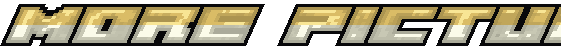


